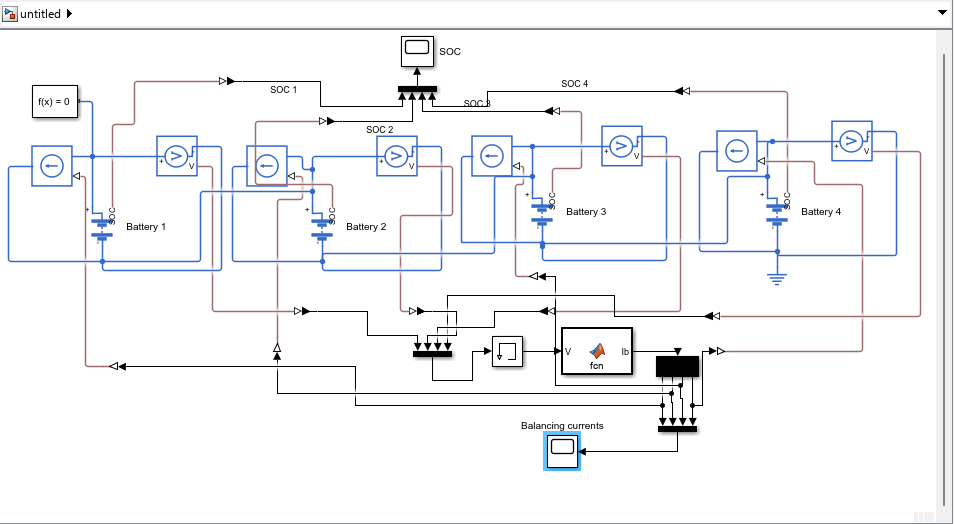
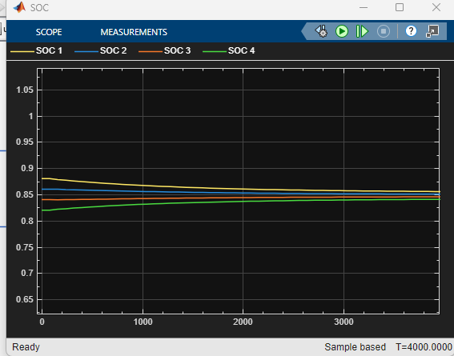

# Active Cell Balancing of a 4S Battery Pack (Simulink / Simscape)

A Simulink / Simscape model of four lithium-ion cells in series with active balancing: charge is moved from fuller cells to emptier neighbours instead of being burned in a resistor. Built as Day 11 of a 30-day self-study plan on battery management systems.

Author: Ali Sher

## Idea
In a series string every cell carries the same current, but the cells are never identical, so their charge levels drift apart. The fullest cell stops charging for the whole pack, and the emptiest cell stops the discharge. Balancing fixes this.

- **Passive balancing** discharges the fuller cells through resistors, so the pack ends at the level of its weakest cell and the extra charge becomes heat. See my [passive-cell-balancing](https://github.com/alisherbtu/passive-cell-balancing) project.
- **Active balancing** (this project) transfers charge between cells, so the pack stays near its average level and little is wasted.

## Model
- 4 cells in series, each a Battery (Table-Based) block: 3 Ah, R0 = 20 mOhm, OCV from 3.0 V (0 %) to 4.2 V (100 %)
- Initial SOC: 88 %, 86 %, 84 %, 82 % (unbalanced pack at rest, no load)
- A controlled current source across each cell acts as an ideal energy-transfer converter between neighbouring cells (1-2, 2-3, 3-4)
- Controller (MATLAB Function block): for each neighbouring pair, the transfer current is proportional to the voltage difference above a dead band, I = K (|dV| - 4 mV), limited to 1 A, with K = 15 A/V
- The receiving cell gets 90 % of the transferred current (converter efficiency)
- A Memory block in the voltage feedback path prevents an algebraic loop
- Solver: variable-step ode23t, stop time 4000 s

## Results
**State of charge.** The four cells converge from a 6 % spread to about 1 % and settle near 85 %. Cell 1 falls, cell 4 rises, and nothing is dumped as heat.

**Balancing currents.** The transfer currents start at about 0.2 A and decay smoothly to zero as the cells match.

## Comparison with passive balancing
| | Passive (33 ohm bleed) | Active (this model) |
|---|---|---|
| What happens to the extra charge | burned as heat | moved to the lower cells |
| Final level | the lowest cell (about 83 %) | about the average (about 85 %) |
| Time to balance a 6 % spread | about 4350 s | about 3500 s |
| Real hardware | a resistor and a switch per cell | converters (inductor, capacitor or transformer) and control |

## Where each method is used
Passive balancing is the common low-cost choice, for example in e-bikes, power tools and many EV and storage packs, where the mismatch is small and time is available. Active balancing is used where wasted energy and heat matter or where cell differences are large, for example in big packs, packs with aged cells, and weight- or cooling-limited systems such as aircraft and drones. It costs more and adds complexity.

## Tuning note
My first run used K = 100 A/V and the controller chattered between +1 A and -0.9 A for the whole run. The measured cell voltages include the I x R0 drop caused by the balancing current itself. The measured difference changes by about 0.038 V per ampere of transfer current, so a gain of 100 A/V gives a loop gain of about 3.8, which is unstable with the one-step measurement delay. Lowering K to 15 A/V (loop gain about 0.6) removed the oscillation. The price is a slower balance.

## What it shows
1. Active balancing keeps the pack near its average charge, while passive balancing drops it to the weakest cell.
2. The controller gain is limited by stability: a faster loop oscillates when the measurement is disturbed by the balancing current.
3. A wrong sign on the current sources made the imbalance grow in my first run, so actuator direction must be checked before closing a loop.
4. Simscape Battery has a ready-made Passive Cell Balancing block (Simscape / Battery / BMS / Cell Balancing), which does what my Day 10 control chain does. The active controller here is custom.

## How to run
Open `day10_active_balancing.slx` in MATLAB with Simulink, Simscape, Simscape Electrical, and Simscape Battery. Set the stop time to 4000 s and run.

## Limitations
- Ideal energy-transfer model, not a real switched-capacitor or inductor circuit
- Balancing at rest only, with no load or charger
- R0-only cells, no RC dynamics, no temperature or aging
- Neighbour-only transfers: charge moving from cell 1 to cell 4 passes through every cell in between and loses 10 % at each hop

## Next steps
- Balance during charging
- Measure cell voltages while the balancing current is paused, so the I x R0 error disappears
- Model a real switched-capacitor or inductor balancing circuit
